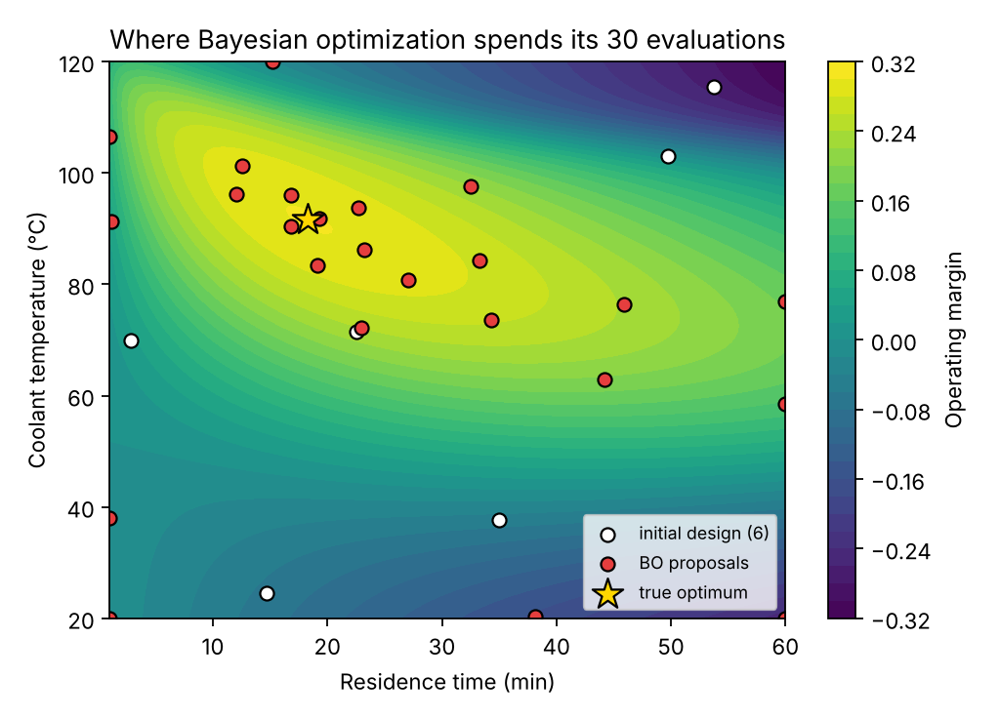
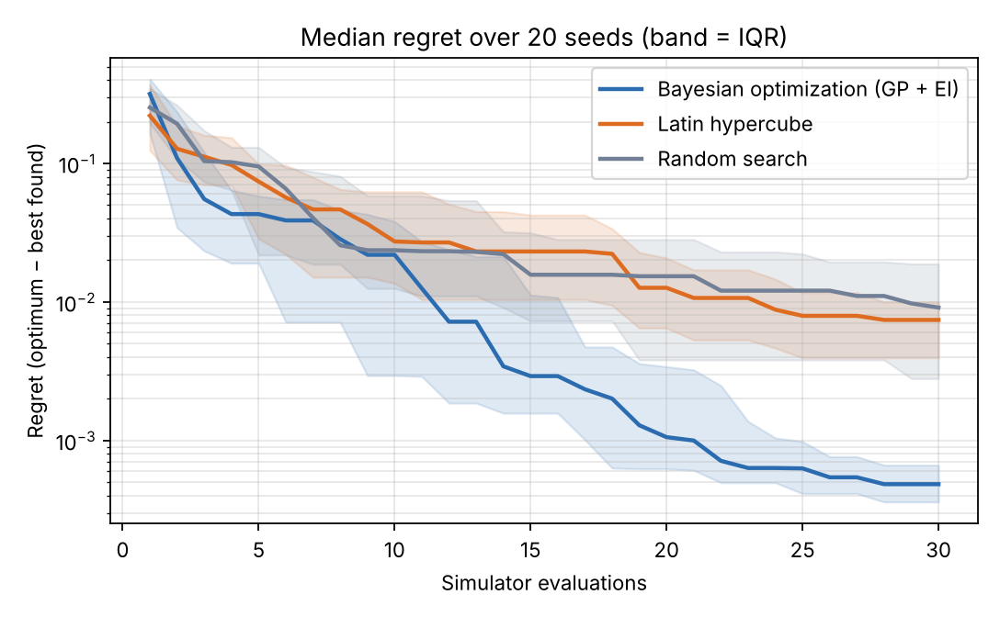

# bayesian-surrogate-optimization

**Find the best operating point of an expensive simulator in as few runs as possible**, using a
Gaussian-process surrogate and Bayesian optimization, and show with a fair benchmark how much it beats
the usual space-filling and random designs.

This is the workflow I used in my PhD, where one CFD/DEM simulation took hours to days: fit a surrogate
with honest uncertainty, let it choose the next experiment, and stop when further runs no longer pay off.
The repo packages that idea on a small, fully reproducible problem.

## The problem

`ReactorSimulator` models a continuous stirred-tank reactor at steady state: a desired exothermic reaction
A → B competes with a side reaction that takes over at high temperature, with a thermal-runaway penalty.

* **Inputs:** residence time (1–60 min) and coolant temperature (20–120 °C)
* **Objective:** operating margin = yield of B − a cost per minute of residence time (throughput)
* **Pretend cost:** every call is treated as an expensive simulation; the budget is **30 runs**



The optimum (★, about 18 min and 92 °C) sits on a tilted ridge next to the runaway region. After a
6-point Latin-hypercube start, Bayesian optimization (red) concentrates its runs on the ridge instead of
spreading them evenly.

## Results

20 random seeds, 30 evaluations each, scored on the true (noise-free) value of the best point found
(`python -m bso.benchmark`):

| Method | Median final regret | 90th-percentile regret | Runs within 1% of optimum | Median runs to reach 1% |
|---|---|---|---|---|
| **Bayesian optimization (GP + EI)** | **0.0005** | **0.0010** | **100%** | **16** |
| Latin hypercube | 0.0074 | 0.0150 | 20% | > 30 |
| Random search | 0.0091 | 0.0372 | 30% | > 30 |



* Bayesian optimization reaches within 1% of the optimum in **every** run, typically after **16**
  simulations. The space-filling designs get there in only 20–30% of runs, even with all 30.
* Median final regret is about **15× lower** than Latin hypercube's, and the worst cases (90th percentile)
  are 15–38× better.

### Is the surrogate trustworthy?

A surrogate is only useful if its uncertainty is honest. Fitting the same GP on 30 points from each design
and scoring it on a dense 60×60 grid:

| GP trained on | RMSE, whole space | RMSE, top-10% region | 95% interval coverage |
|---|---|---|---|
| BO samples | 0.022 | **0.007** | 89% |
| Latin hypercube | 0.039 | 0.021 | 84% |

BO data gives a surrogate that is **3× more accurate where it matters** (near the optimum). Coverage of
the nominal 95% intervals is 84–89%, so the GP is slightly over-confident. That's worth knowing before
using its error bars for decisions; a common fix is to inflate σ or use a heavier-tailed likelihood.

## Quick start

```bash
git clone https://github.com/bjadidi/bayesian-surrogate-optimization && cd bayesian-surrogate-optimization
pip install -e ".[dev]"
python -m bso.benchmark --seeds 20 --budget 30      # ~1 minute; writes reports/*.png and benchmark.json
python -m bso.benchmark --noise 0.005               # same benchmark with noisy simulator outputs
pytest -q
```

Use it on your own function:

```python
from bso.optimize import bayes_opt
from bso.simulator import Bounds

bounds = Bounds(names=("x1", "x2"), low=(0, 0), high=(1, 10))
history, gp = bayes_opt(my_expensive_function, bounds, budget=25)   # maximizes
```

## How it works

* **Surrogate:** scikit-learn GP with a Matern-5/2 kernel (separate length scale per input), a learned
  noise term, normalized targets, and inputs scaled to the unit square.
* **Acquisition:** Expected Improvement, maximized by scoring 4,000 random candidates and then refining
  the best five with L-BFGS-B.
* **Initial design:** 6-point Latin hypercube.
* **Fair scoring:** every method is scored by the true value at the point it *believes* is best, never
  by a noisy observation.

```
src/bso/
  simulator.py   reactor model, bounds and unit scaling, true optimum (for scoring only)
  optimize.py    GP, Expected Improvement, Bayesian optimization, random and LHS baselines
  benchmark.py   multi-seed benchmark, surrogate-quality check, plots
tests/           behavioural tests (EI properties, BO beats random, scaling, seeding)
```

## Limitations and next steps

* 2-D for clarity; standard GPs scale well to roughly 10–20 inputs before you need trust regions
  (TuRBO) or additive kernels.
* One run at a time. Batch acquisition (q-EI or local penalization) would use parallel simulators.
* Unconstrained. Real processes add safety limits (e.g. maximum reactor temperature), handled with a
  second GP on the constraint and constrained EI.

## License

MIT
